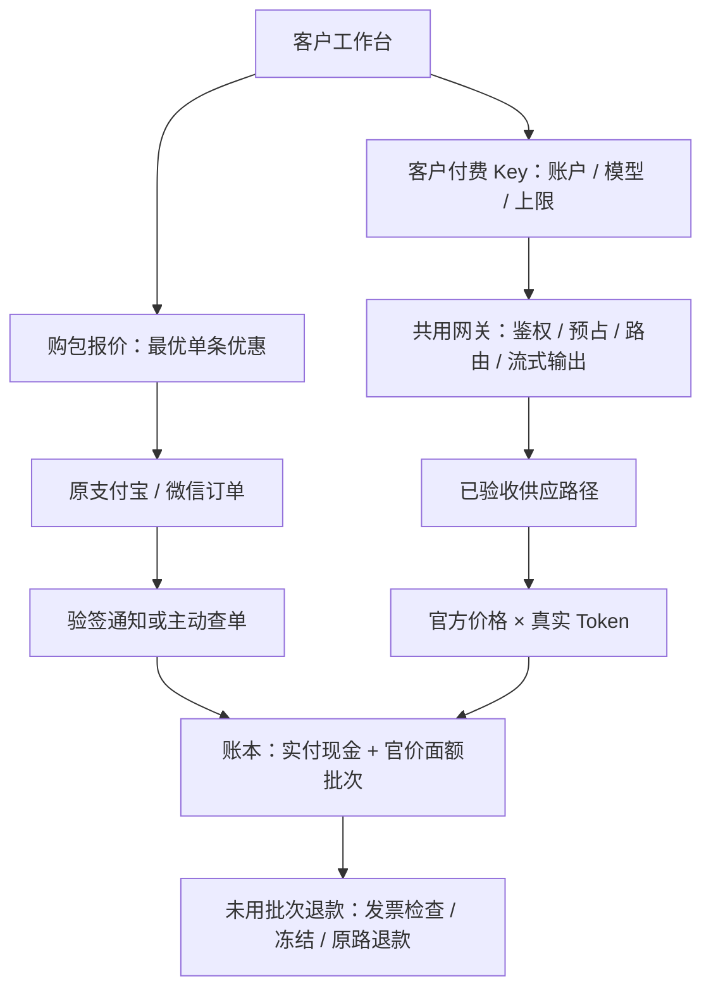

# 实际技术架构

2026-11-14 更新。本页描述当前源码；客户付费扩展仍须发布及真实商户验收。早期 React/Next.js、TypeScript、LiteLLM 和独立队列方案是候选，当前未使用。

## 部署与页面

Caddy 承接公网 HTTPS；静态 HTML/CSS/JavaScript 提供模型广场、价格、个人及企业工作台。员工界面位于受员工认证保护的现有 workspace。Node.js / Express 模块化服务处理身份、业务、模型请求和周期对账，PostgreSQL 保存真实业务状态。客户使用 Better Auth 邮箱身份；员工使用 Authentik OIDC/MFA 与岗位授权。

页面继续使用现有 hash 路由。购包和退款申请放在账单页，付费 Key 放在密钥页，调用状态放在用量页；财务在原支付订单页审批原路退款。没有新增第二套客户控制台。

## 账本和隔离

- `payment_orders` 冻结面额、实付和优惠快照；重复支付通知不重复入账。报价不是收款凭证。
- `billing_accounts` 保留现金与官价面额两个余额。`credit_packs` 保存每次实际入账的来源、原面额、实付、剩余面额与累计已消耗现金。
- `customer_api_keys` 仅保存摘要和提示，明文创建时展示一次；请求时重新核验身份和企业管理权限。企业普通成员付费预算分配尚未接通。
- `customer_calls` 保存预占、价格快照、Token 和结算状态；`credit_consumptions` 逐批次记录官价及对应实付消耗。账户行锁串行化预占、扣款和退款，单账户最多 10 个进行中请求。
- 内部额度仍使用 `employee_*` 表，不会消耗客户现金；共享的是网关处理函数，不混用资金来源。
- 面额精确到 10 位小数分，现金以整数分累计确认，避免大量小额调用被逐笔取整吞掉或多扣。

## 失败与补偿

有可信 Token 用量才按快照官方价格结算。响应缺少 usage 时保留预占并等待供应日志；24 小时仍无证据则释放，不用估计预占额扣客户钱。周期任务也回收中断进程的请求。每次结算以调用状态和事务防重。

退款必须结清本账户在途请求；按整个未用批次计算，已开销项发票阻止退款。渠道结果未明时冻结该批次，成功记退款和手续费，明确失败恢复原额度和现金。开票和退款共享账户锁，退款处理中不能开票。

对公入账继续复用财务登记、第二人复核机制。**对公退款仍需人工线下处理，当前未提供自动账本闭环**，界面明确提示联系财务；不能当作在线退款已完成。

## 开放边界

付费调用默认关闭。部署需要配置 `CUSTOMER_PAID_ENABLED=true`、明确的 `CUSTOMER_PAID_MODELS` 白名单以及现有供应凭证配置。代码开关不替代商户实际付款、通知、调用及退款验收。两区域共用代码仍是方向，本次没有新增 AWS 环境、独立队列或微服务。
