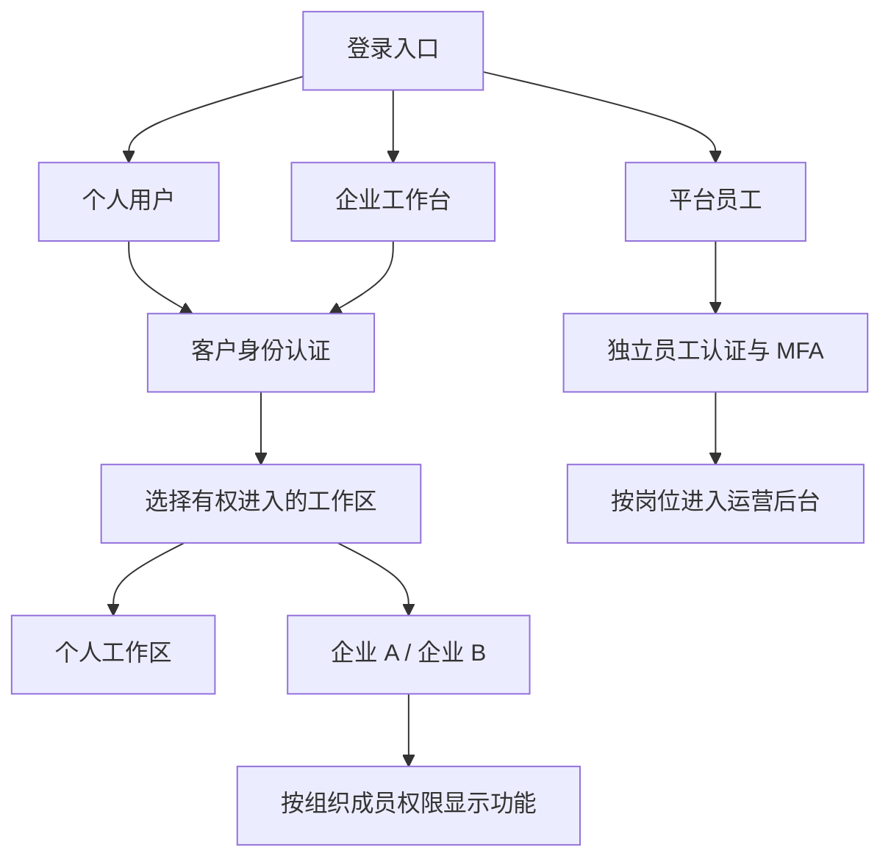

# 企业工作台：竞品研究与 OneAPI 设计建议

日期：2026-11-06。状态：研究与设计方案；本章不是已实现功能清单。以官方公开文档为依据，未登录三家企业租户实测。不同版本、合同与地区可能有差异；引用的是本次查阅时的文档。本方案接续身份、支付和公开上线基线；细化建议未自动成为用户批准的商业条款。

## 1. 已确认的产品目标

用户确认对外有个人、企业客户、平台员工三类入口。企业客户充值后，自主管理企业成员及权限，分配、调整、回收使用额度，跟踪消费。例如企业 A 充值 ¥1,000，为 10 名成员各分配 ¥100。平台员工指 OneAPI 经营方的工作人员，企业成员始终属于客户侧。

统一产品体验，分别管理身份、组织关系、授权与资金；不能把这四件事都塞进登录回调。个人和企业复用客户身份基础；平台员工使用独立授权域。任何入口选择、邮箱后缀或前端 role 值都不授予权限。

## 2. 三家可借鉴之处

| 对象 | 官方文档确认的能力 | OneAPI 采纳建议 |
| --- | --- | --- |
| WorkBuddy 企业版 | 成员用量表按周期、部门、成员筛选；单人和批量调限额；全员调整可更新新成员默认额；成员可看自己的用量 | 以成员表为日常管理中心，提供批量分配、调整预览和自己的额度页 |
| Codex / ChatGPT 企业工作区 | 区分席位、管理角色、功能权限；符合条件的工作区有每人默认限额、组默认值、个人覆盖及加额申请；API Platform 账单是另一边界 | 分开“能做什么”和“能用多少钱”，个人与企业有明确工作区；接入客户端与企业钱包分开建模 |
| Claude / Claude Code 企业管理 | 企业共享用量与费用管理；角色可区分查看和管理；可查看成员最终生效权限；Claude Code 有用量及采纳分析 | 做可解释的权限面板、预算告警和加额审批；用量分析与业务账本分开 |

WorkBuddy 证据：[成员用量](https://cloud.tencent.com/document/product/1831/139896)、[角色管理](https://cloud.tencent.com/document/product/1831/134412)。腾讯文档还区分标准版与企业微信联合版，后者并不拥有标准版全部管理功能，不能混为一种配置：[版本差异](https://cloud.tencent.com/document/product/1831/139460)。

Codex 证据：[角色与工作区权限](https://learn.chatgpt.com/docs/enterprise/roles-and-workspace-permissions)、[企业管理 FAQ](https://learn.chatgpt.com/docs/enterprise/work-admin-faq)、[用量与费用控制](https://learn.chatgpt.com/docs/enterprise/usage-limits)。工作区预算不等于 OpenAI API Platform 项目余额；不能承诺第三方 API Key 自动获得 Codex 企业席位权益。

Claude 证据：[企业费用与共享消费](https://support.claude.com/en/articles/11526368-how-am-i-billed-for-my-enterprise-plan)、[自定义角色及生效权限](https://support.claude.com/en/articles/13930452-manage-custom-roles-on-enterprise-plans)、[Claude Code 用量分析](https://support.claude.com/en/articles/12157520-claude-code-usage-analytics)。费用控制依计划类型区分；采纳/贡献分析需要相应数据，不能由 token 量直接推断员工产出。

研究结论：采用成熟产品的管理结构，按 OneAPI 的 API 采购与销售业务重建资金规则。三家文档中的个人上限不能直接当作已经预留的独立余额。首版建议提供有资金支持的明确额度分配，不先引入复杂席位套餐，也不将他们的价格直接套入我们的商品。

## 3. 登录与工作区结构

| 展示入口 | 登录后的工作台 | 开通与身份 |
| --- | --- | --- |
| 个人用户 | 我的模型、项目与 Key、余额、用量、账单 | 公众注册 customer；个人工作区 |
| 企业工作台 | 企业概览、成员、额度、项目、分析、账单、审计 | 同一 customer；创建企业或接受邀请/后续企业 SSO；权限来自本组织 Membership |
| 平台员工 | 客户服务、供应运营、商品、订单资金、促销、审计 | 管理员开通 staff，按岗位授权，MFA；不接受公众注册 |

“企业工作台”同时服务管理员与成员，不只写“企业管理员登录”。无企业成员资格者可以创建企业或接受邀请，不能凭输入企业名称加入。一个客户可在企业 A 是管理员、企业 B 是普通成员，同时有个人工作区。

每个页面固定显示当前企业、地区、币种和身份；切换工作区不搬余额、不搬 API Key、不继承另一企业权限。个人账户存在不代表可以把企业请求转为个人付费；达到企业限额时明确阻断/申请加额，不静默切账。

## 4. 权限设计

`customer` / `staff` 是身份域；`owner` / `organization_admin` 等是指定组织内的角色。界面使用中文名称，避免“客户就是 owner”的歧义。首期用固定角色模板和明确权限点，后续开放完整自定义角色编辑器。

| 角色 | 默认范围 | 可以做 | 不自动拥有 |
| --- | --- | --- | --- |
| 企业所有者 owner | 全企业 | 企业设置、管理员任命、授权、预算、所有权转移 | 平台运营权限、上游采购凭据 |
| 企业管理员 organization_admin | 全企业或获授权部门 | 邀请/暂停普通成员、分配范围内额度、项目管理、用量分析 | 转移所有权、任命同级/更高级管理员、扩大自己范围、退款与支付设置 |
| 财务 billing | 全企业或获授权账单范围 | 查看账单与消费、充值与发票；预算管理为单独可授权限 | 成员身份管理、API Key 原文、模型请求内容 |
| 部门/项目管理员 | 明确部门或项目 | 管理范围内成员/项目资源、按授予预算调配 | 跨部门拿额度、管理未授权项目、任命管理员 |
| 企业成员 member | 自己和获授权项目 | 使用已批准模型、创建获准 Key、查看本人用量、申请额度 | 全企业账单、他人用量、角色和额度变更 |
| 只读审计 viewer | 明确报表/审计范围 | 查阅和导出获授权记录 | 任何写操作或模型调用（除非另授使用权） |

member 是统一的普通成员角色；旧方案中的 developer 细化为该成员获授的项目/API 使用权限，不再作为第二个同义身份。项目管理员与部门管理员分别使用 project_admin / department_admin，并绑定具体资源范围。

权限拆为动作、资源范围、预算授权三个维度。多角色可以增加动作授权，但不能突破组织/地区隔离、明确禁用、模型限制和费用上限。调用必须同时通过成员、项目、Key、模型与余额校验。管理角色变更记录操作者、前后权限和范围；最后一名 owner 不能被直接移除。

成员详情提供“当前有效权限”：可做什么、作用在哪些部门/项目、来源角色、可用模型、预算来自哪里、为何被阻断。管理员能够分配的权限必须在其可委派清单内，不能通过创建角色给自己提权。

## 5. 企业充值与成员预算

### 5.1 两本逻辑账，实际资金只属于企业

企业资金账本记录已到账充值、消费、退款、赠送及在途预占。成员预算记录企业内部授权分配，不是向个人钱包转账。赠送额度保留模型范围与到期条件，不能在分配后变成现金或可退款本金。

首期建议“固定分配模式”：预算持续有效，直至用完、回收或明确到期；不默认每月重发。月度自动预算作为后续能力，必须明确周期、时区、结转和资金不足时的行为。月度限额重置不产生新的企业资金。

### 5.2 ¥1,000 / 10 人示例

初始充值确认到账 ¥1,000；批量选中 10 名成员，每人分配 ¥100。企业未分配额为 ¥0，企业余额仍为 ¥1,000，并未发生消费。

假设成员 1 已消费 ¥30、在途请求预占 ¥5，则其剩余可新调用/调出的额度为 ¥65。管理员向成员 2 调拨 ¥40：

| 项目 | 调拨前 | 调拨后 |
| --- | ---: | ---: |
| 成员 1 总预算 | ¥100 | ¥60 |
| 成员 1 已消费 / 在途 | ¥30 / ¥5 | ¥30 / ¥5 |
| 成员 1 可用 | ¥65 | ¥25 |
| 成员 2 总预算（假设尚未使用） | ¥100 | ¥140 |
| 企业已消费 | ¥30 | ¥30 |
| 企业账面余额（含预占） | ¥970 | ¥970 |

调拨不产生新充值、销售订单、优惠或返佣。不能移走已消费和在途预占部分。调拨必须在一个事务中完成；重复提交不会调两次。

对于该示例，企业净入账资金 = 已结算消费 + 在途预占 + 各预算未使用授权额 + 企业未分配额。项目预算若与成员预算同时约束同一请求，是两道上限，不重复分配或重复扣款。服务账户单独标识预算负责人，不能冒用成员身份逃避限额。

### 5.3 管理动作的准确含义

- 增减额度：从企业未分配池分配或回收，不低于已消费加在途金额；余额不足给出缺口。
- 调拨额度：在有权管理的两方之间移动未使用预算；跨授权范围由上级处理。
- 暂停成员：阻止新请求与新 Key，默认保留预算；可另外选择“暂停并回收未使用额度”。恢复成员需要明确操作。
- 移除成员：撤销该企业成员资格和成员 Key；保留历史账单与审计；回收未使用额，在途完成后结清。组织服务账户需要交接或撤销，不能一概随人删除。
- 调整部门：从生效时起采用新部门权限/预算策略；历史费用保留原归属，不能迁移后重写报表。
- 余额不足/超限：拒绝新调用，展示具体原因和申请入口；不自动向其他成员借款，不自动扣个人余额。

### 5.4 实现条件

入站请求在服务端原子校验并预占可计价的费用上界；流式、多轮、并发及重试同样受控。请求结束按实际用量和已锁定价格版本结算，释放差额；未知用量保留待核对，不能随意释放可能已经发生的成本。无法给出成本上界的供应产品不宣传硬限额保证，正式接入前必须定义可执行的边界。

内部以定点高精度金额计算，展示时保留分；不逐请求四舍五入到分造成小请求免费。每笔扣费只发生一次，并保存 request_id、企业、成员/服务账户、项目、Key 标识、商品价格版本、输入/输出/缓存用量和费用。浏览器里的预算数字不是实际授权依据。

## 6. 企业工作台页面方案

沿用珍珠白背景、白色卡片、蓝色操作、青紫图表和高密度表格；与平台后台共享组件，但导航、权限和数据独立。企业管理员不能看到供应采购价、平台毛利、供应商密钥或别家企业。

导航建议：企业概览 / 成员与部门 / 额度与预算 / 项目与 API Key / 用量与分析 / 账单与充值 / 审批与记录 / 企业设置。

首屏四张卡片：企业可用余额、已分配未使用额度、当前周期消费、活跃成员。另显未分配余额与在途占用，避免“余额”和“可分配额”混淆。待办显示额度申请、临近限额、预算耗尽、即将到期邀请。每块用量标记统计区间及更新时间。

成员管理表：成员、部门、角色、使用状态、预算总额、已消费、在途占用、可用额度、最近使用、操作。提供搜索/筛选/批量邀请/批量分配/调拨/暂停。批量操作明确展示受影响成员数量、总额度、余额缺口及失败原因，默认整体校验后执行，避免只完成一半却提示成功。

点击成员打开右侧详情：概览、用量、有效权限、API Key 掩码、操作历史。额度调拨对话框同时列出双方变更前后值和不可转移金额。危险操作明确说明影响；企业成员自己的页面只展示自己的额度、获授权项目、Key 和申请进度。

用量分析按时间、成员、部门、项目、模型汇总；明细包括输入/输出/缓存 tokens、调用数、费用、错误与延迟。按 Key 和项目可信归属追踪；客户端标签属于辅助信息，不能用可伪造 User-Agent 作为扣费/授权依据。无需保存提示词和输出正文即可完成基础分析，不把 token 使用量当绩效评分。

## 7. 与其他模块连接

- 模型广场：展示企业可买/可用的商品和企业有效价格；成员不能改变全企业优惠。
- 项目接入：组织项目创建项目/成员或服务账户 Key；每个 Key 绑定企业、项目、调用主体和模型策略。上游采购密钥只在服务端。
- 供应验证：客户端适配按实际版本与协议验证。WorkBuddy、Codex、Claude Code 的企业席位、OAuth 登录和第三方兼容 API 是不同产品能力；未验证的客户端不标为可接通。
- 支付：以企业 BillingAccount 下单，确认到账再发可用资金；财务退款必须扣除消费、在途和不可退权益，并相应收回预算授权。
- 促销：挂在企业计费账户和价格/权益版本上；成员调拨不重复领取、不计佣；合格实际消费才进入现有佣金规则。

## 8. 首期实施与验收

第一批：三入口、客户身份/企业成员关系、固定角色与作用范围、邀请/停用/工作区切换。第二批紧接实现企业钱包、10 人批量分配、回收/调拨、每请求预占与结算、成员用量。第三批接入真实支付、模型调用、告警和加额审批，完成全链路后直接开放公众注册。

后续扩展：企业 SSO/SCIM/企业微信通讯录同步、自定义角色编辑器、多层部门预算、月度模板、管理 API。数据结构预留，首版不同时承诺这些集成全部可用。

必须通过的业务验收：

1. 企业 A 的管理员/成员不能访问企业 B；客户不能访问平台员工接口。
2. ¥1,000 分成 10 × ¥100 后不可再额外分配 ¥1；消费、回收、退款后等式仍成立。
3. 并发调用与调拨抢同一额度不会超卖；请求/支付/调拨重放不会重复入账。
4. 已花 ¥30、在途 ¥5、预算 ¥100 的成员最多调出 ¥65。
5. 暂停后已有 Key 不能发新请求；移除只撤销目标企业访问，不删除个人或别家企业资格。
6. 部门管理员不能跨部门调拨、改自己管理范围或任命 owner。
7. 个人/企业切换不会串余额、项目、Key、优惠或账单；成员只能查看被授权明细。
8. 预占/扣费/结算/退款/审计可核对；用量看板延迟不能绕过实时费用门禁。

后续实施已加入三入口与企业预算交互原型，见 [五模块实施进度](10-implementation-tracker.md)。线上仍为 UI 预览，不创建真实企业成员、不持久保存额度、不收款、不调用模型。下一步接真实后端；界面演示与内存规则测试不能替代上述业务验收。
