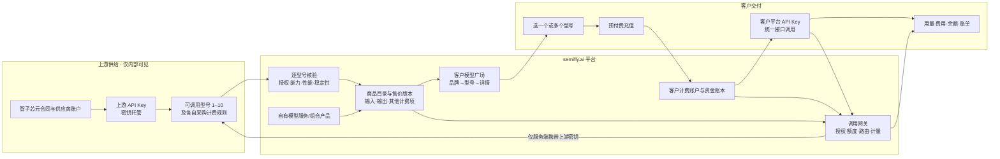
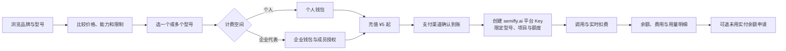

# 从上游 API 到客户交付：产品蓝图

状态：2026-11-07 产品逻辑稿。用户确认预付人民币余额、可选多个型号、¥5 起充、未用金额可申请退款；本文的型号、金额、性能均非真实报价或 SLA。退款的 15% 手续费尚待法务与支付渠道核验，不是已发布条款。

## 一张图讲清我们采购、加工和交付什么

**我们采购**的是合同约定范围内的 API 调用能力及其成本规则。**我们交付**的是 semifly.ai 名下、由我们定价、接入、计量、支持和保障的模型 API 服务。客户不购买、接触或下载上游 Key，也不等于租赁上游机器。上游提供某型号，不自动代表我们拥有转售权或品牌使用权；签约时必须核对转售/再分发、子用户使用、数据处理、区域、并发、赔付和终止后的客户迁移权。

## 目录、型号和商品是不同对象

| 对象 | 内部必须保存 | 客户如何看到 |
| --- | --- | --- |
| SupplierAccount / Credential | 合同主体、账户、密钥引用、共享限流/余额、轮换记录 | 完全不显示 |
| SupplierModelOffer | 上游精确 model ID、能力、采购价版本、调用条件 | 不展示采购价和账户 |
| ModelVersion | 品牌、型号版本、能力和限制、验证证据 | 型号详情、适用场景与限制 |
| SellableProduct | 区域、可售状态、售价版本、服务承诺、允许的供应路径 | 模型广场卡片与报价 |
| CustomerAccessGrant | 客户/项目/员工可用的一个或多个商品 | “我的模型”、平台 Key 权限 |
| BillingAccount | 个人或企业人民币实付余额、赠送权益和负债 | 余额、预算、明细和可退金额 |

一个上游 Key 可能开放十个 model ID，但各型号的采购价、限流和稳定性不同；它们可能共用一组上游余额与并发上限。每个型号单独验收和发布。一个品牌可有多个版本；同一型号可有备用供应商，客户价格保持按已公布版本计算。供应商故障导致的重试成本归我们核算，不自动转嫁客户。

## 模型广场的实际呈现

先展示**品牌与模型家族**，进入后看**精确型号与版本**；客户可将一个或多个型号加入“我的可用模型”。型号卡片至少包含：一句话适用场景、输入与输出单价及单位（例如元/百万 Token）、可用状态、最近验证时间和主要限制。详情还应列出上下文窗口、最大输出、模态、流式响应、工具调用、结构化输出、推理模式、缓存或图片等额外计费项、地域/数据处理约束、接口示例与版本变更。没有核验的数据写“待验证”，不能填示意数字冒充真实性能。

性能按**我们实际供应路径**测量，不抄上游宣传值。至少记录测试窗口、样本量、成功率、首 Token 延迟 p50/p95、完整响应耗时 p95、吞吐/并发、错误类型；可以展示与该型号有关的质量评测及方法，但不把主观“聪明程度”伪装成单一分数。价格和性能都要显示更新时间。不同型号的缓存、图片、音频等计费规则不能硬套进只有输入/输出两个框的表格。

模型状态建议为：`候选` → `合同授权核验` → `技术测试` → `定价审核` → `可售` → `降级/暂停` → `下架`。只有可售型号能创建真实订单和可调用授权；目录预览必须清楚标注。

## 客户的两条主要路径

选择型号是**授权选择**，充值是**给计费账户增加人民币实付余额**，两者不绑定成“一次充值只买一个型号”。客户可在权限范围内更换或增加型号，未来调用按各型号当时生效且已告知的价格版本扣费。企业代表人充值企业钱包，给员工设允许型号和人民币预算；员工不会因此获得上游 Key 或企业付款权限。一次请求开始时固定商品、价格、优惠和路由版本，预留足够额度；完成后按有效用量结算，失败/取消释放或按明确规则扣费。客户平台 Key 单独生成，只显示一次，服务端保存不可逆校验值及权限，不与上游 Key 混用。

需要防止“账上有钱但上游无可用供应”：网关在调用前同时检查客户授权与预算、商品可售、供应路径健康、上游余额/并发及降级策略。客户余额不能作为供应可用性的证据。

## 价格与资金的口径

| 钱/量 | 口径 |
| --- | --- |
| 上游采购成本 | 按供应商合同及实际响应计量，独立核算，绝不显示给客户 |
| 客户单价 | 每型号、地区、计费维度的公开售价版本；单位与税口径明确 |
| 客户实付余额 | 已经支付渠道确认的人民币本金，不叫“Token 余额” |
| 用量 | 输入/输出 Token、缓存、图片等原始计量；与人民币费用分开显示 |
| 促销权益 | 单价折扣或赠送权益，单独记账，不伪装成可退本金 |
| 退款可用额 | 未消费、未锁定的**实付**批次余额；需扣除在途调用并核对原支付订单 |

用户提出**最低 ¥5、无平台业务最高充值额**。实现上金额至少受支付渠道单笔限额、实名/风控和企业合同约束，界面应据实际收银能力给出可充值范围，不能承诺支付渠道也“无上限”。订单、支付回调、余额入账和退款均使用幂等键与可对账流水；“点击付款成功页”不能替代支付渠道的已到账确认。

**退款业务建议**：先计算可退未消费实付本金，冻结对应额度与在途请求，按原支付交易分批发起部分/全额退款；等待支付渠道最终结果后冲减账本。过期或失败的原路径退款转异常客服流程，不以站内余额扣减替代完成退款。微信支付支持原支付订单部分退款，但还须遵守其渠道条件。[微信支付订单退款文档](https://pay.wechatpay.cn/doc/v3/merchant/4013071001)

**15% 手续费是商业提案，不是开发默认值。**如果适用的合同与法律最终允许这类费用，计算基数建议只取符合条件的未消费实付余额，明示计算方式，并在提交退款前展示净退款额。例如充值 ¥100、已消费 ¥30、未用 ¥70，按提案计算为手续费 ¥10.50、原路退 ¥59.50；这只是算例。个人消费者的预付款及格式条款可能受退款权、合理费用和无效条款规则约束；企业合同也应单独审查。平台原因不能履约、依法应全额退款等情形应走相应规则，不能统一扣 15%。上线前由法务确认适用场景和书面条款，财务确认手续费税务口径，支付团队核对各渠道的退款能力。[消费者权益保护法实施条例第 17、22 条](https://app.www.gov.cn/govdata/gov/202403/19/513111/article.html)、[最高法预付式消费司法解释第 1、14、15 条](https://www.shandan.gov.cn/zfxxgk/xzzfxgk/chz_7381/xzswgk06/ggflfw_7392/fzxcjy_7394/202504/t20250416_1387833_ghb.html)

## 我们自己的“模型”可以是哪种产品

| 类型 | 实际交付 | 标注与上架条件 |
| --- | --- | --- |
| 自托管基础模型或微调版本 | 我们在自有/租赁算力运行允许商用的权重和推理服务 | 确认模型权重、训练数据与商用许可；自有版本、运维和成本独立记录 |
| 基于上游的 semifly.ai 增值服务 | 在授权的上游型号之上做工作流、路由、RAG 或结构化处理 | 明示“基于/由……提供底层能力”，核对衍生服务与转售许可；上游成本和额外处理成本均计入定价 |
| 多供应商组合产品 | 按策略调用多个已获准的型号、提供统一任务结果 | 公开客户最终计价单位和适用限制；内部保留每条路由的成本与证据 |

首期更容易实现的是**有清楚用途和差异的增值 API 产品**，但不能把上游型号改名就称作“自研基础模型”。无论来源如何，客户都看到同一套可比较的商品信息、价格版本、平台 Key、用量和账单；内部保留不同来源、供应路径和成本计算。

## 上游密钥是核心资产

供应管理员在内部受限页面经 TLS **一次性提交**上游 Key；后端写入阿里云 KMS 凭据服务，业务库只保存凭据标识、版本和脱敏尾号。运行时网关用最小权限的服务身份读取，内存中短时使用，不把明文回传浏览器，不写入日志、追踪、分析事件、错误信息、Git、备份明文或客服工单。客服和普通运营只能看状态及尾号，不能导出或复制。权限修改、读取、轮换和异常访问留审计。生产与测试密钥及权限隔离；新旧 Key 轮换应先验证新 Key 和所支持型号，再切流并撤销旧 Key。KMS 托管可降低明文存储风险，但**通用凭据不会替我们自动轮换供应商 Key**，轮换流程仍须设计和执行。[阿里云 KMS 凭据管理概述](https://help.aliyun.com/zh/kms/key-management-service/user-guide/secret-management-overview)

发布前做一次泄露演练：网页响应、浏览器存储、应用与代理日志、APM、错误上报、数据库备份均不得出现上游 Key；若泄露，能停用旧凭据、切换新凭据并追溯影响。供应商若支持 IP 白名单和子 Key，应使用最小作用域与独立测试 Key。

## 接下来可落地的页面与实现顺序

1. **内部供应台**：供应商合同与授权、供应账户/密钥录入、型号发现、分型号测试、采购价版本、发布审批。首页保留用户确认的每供应商“供给类型、阶段、负责人、待解决问题、最近测试结果”。
2. **模型广场**：品牌目录 → 真实型号详情 → 多选清单；未发布型号清楚标记。先把当前匿名 `demo-*` 隔离为演示数据。
3. **个人/企业购买台**：型号选择、人民币充值订单、支付确认、余额与退款入口。企业代表可分配成员预算与型号；成员只在授权范围内使用。
4. **接入与计量**：平台 Key、统一调用协议、额度预留/结算、客户用量与供应成本双账、异常与对账。
5. **自有产品与促销**：自有服务按相同发布门槛上架；促销只作用于清楚定义的商品和消费，不混入可退本金。

当前公开环境只有隔离模拟链路，没有供应商真实 Key、真实可售型号、真实支付或真实推理；本文是改造蓝图，不应把演示数字转成实际余额或业绩。[现有产品契约](16-customer-product-contract.md)、[供应管理](07-supplier-operations.md)、[支付与促销](03-payments-and-promotions.md)。
