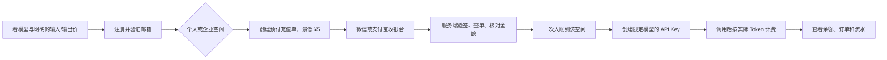

# 预付充值：个人与企业共用一套资金规则

状态：2026-11-07。用户已确认最低充值 ¥5、未用资金希望可原路退回并拟收 15% 手续费；微信和支付宝商户尚未开通，首发模型的客户人民币单价尚未批准。本阶段只上线真实账户的只读视图和隔离账本基础，不产生真实充值单、不接收付款通知、不增加余额。

## 客户走的路

选模型是使用授权，不是把充值款锁定在某个模型。个人余额只供个人调用；企业余额只供该企业使用，代表人管理充值、可退资金和员工预算，员工不能给企业充值或申请退款。一个自然人同时有个人和企业身份时，两个账本和 API Key 分开。币种首版只用人民币分；所有金额用整数计算。

## 资金规则与不变量

- 充值单在向商户下单前生成唯一商户单号与固定金额；前端返回成功、截图或用户手输订单号都不能让余额增加。仅服务端验证商户签名并查询确认订单后，在同一个数据库事务里更新订单、账户和流水。
- 通知可能重复或乱序；商户交易号、商户单号和流水业务引用必须唯一。重复通知只返回已处理结果，金额、币种、商户号或归属不符要拒绝并进入人工核对。[微信支付官方开发指引](https://pay.wechatpay.cn/doc/v3/merchant/4012089542)也要求验签并核对订单金额。
- 每次余额变动都锁定账户行，写一条不可随意覆盖的流水；调用前预留足额余额，结束按真实用量结算，失败释放预留。企业员工额度是企业钱包内的消费上限，不是员工的独立现金余额。
- 退款只能取未消费的实付余额，并关联原充值交易。申请时先冻结对应余额，商户确认退款成功后再完成账务；失败则解冻。[微信支付官方退款指引](https://pay.wechatpay.cn/doc/v3/merchant/4013071031)将申请退款和最终退款结果分开处理。
- 用户提出的 15% 手续费需要在客户展示条款、财务和支付渠道核验后再决定计算口径、金额上限及例外场景；目前接口不计算或收取此费用。活动赠额若将来上线，必须与可退实付款分别记账。
- 每日对账比较平台充值单、商户账单和资金流水；差异只做冲正新记录，不改历史行。退款、补单和调整均记录操作人和原因。

## 本阶段代码边界

`billing_accounts` 与 `billing_ledger` 和模拟 `demo_*` 表物理隔离。`GET /api/billing/personal` 只读个人账户；`GET /api/billing/organizations/:org` 只允许有效企业代表人读取企业账户。无商户时返回零余额和停用的充值能力，不创建虚假交易。下一阶段在首发型号售价与商户资料具备后，增加充值订单、商户适配器、验签/查单、幂等入账、对账与退款流程，并用隔离商户沙箱做并发和重复通知验收。
