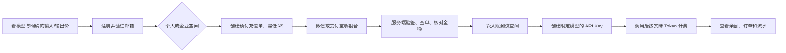

# 预付充值：个人与企业共用一套资金规则

状态：2026-11-07。用户已确认最低充值 ¥5、未用资金希望可原路退回并拟收 15% 手续费；微信和支付宝商户尚未开通，首发模型的客户人民币单价尚未批准。本阶段只上线真实账户的只读视图和隔离账本基础，不产生真实充值单、不接收付款通知、不增加余额。

## 客户走的路

选模型是使用授权，不是把充值款锁定在某个模型。个人余额只供个人调用；企业余额只供该企业使用，代表人管理充值、可退资金和员工预算，员工不能给企业充值或申请退款。一个自然人同时有个人和企业身份时，两个账本和 API Key 分开。币种首版只用人民币分；所有金额用整数计算。

## 一个邮箱、多个空间、分别付款

登录身份是全局唯一的用户 ID，邮箱只用于登录与验证。企业不是第二套邮箱账号，而是 `organizations` 与 `memberships`：同一用户可以拥有个人空间，并在多家企业分别担任代表人或员工。切换空间只切换当前操作范围；服务端每个请求仍须重新检查成员关系和权限，不能信任浏览器传来的空间名称。

`billing_accounts` 已按个人 `owner_id` 或企业 `organization_id` 二选一建立账户，数据库保证一个用户只有一个个人资金账户、每家企业只有一个企业资金账户。账户之间没有自动转账，也不把余额汇总成同一个可花余额。员工预算只是企业余额上的消费限制，不是另一份现金。个人和企业 API Key 将分别绑定自己的资金账户与授权模型；一次调用只能扣一个账户。

接通商户时，共用同一套充值订单逻辑，但订单必须同时保存以下独立字段：

| 字段 | 含义 |
| --- | --- |
| `billing_account_id` | 钱最终进入哪个个人或企业账户；下单后不可改变 |
| `initiated_by_user_id` | 哪位已登录且有权限的用户发起充值 |
| `merchant_order_no`、`merchant_transaction_id` | 平台订单与商户实付交易的唯一对应关系 |
| `provider`、`merchant_id`、`amount_fen`、`currency` | 支付渠道、收款商户、金额与币种，供验签和对账 |
| `payer_reference` | 商户实际返回且允许保存的付款方标识；不可凭登录邮箱或客户填写信息推断实际付款人 |
| `invoice_subject` | 如客户申请发票，另行记录并核验开票抬头；不等同于实际付款方 |

例如张三使用同一邮箱，给个人空间充 ¥50，又以企业代表人身份给 A 公司充 ¥100：系统生成两笔订单，分别指向张三的个人账户和 A 公司的企业账户。即使两笔付款来自同一支付工具，也分别入账。若 A 公司由另一位付款人完成订单，企业余额仍归 A 公司使用，付款记录保留实际渠道交易信息；退款只针对原充值交易按商户支持的原路径办理，不转到张三个人余额或任意员工账户。付款方身份的展示范围和个人信息留存需按实际渠道能力确定。

企业账户若由多人分次付款，还需要为每笔成功充值保留独立的“实付批次”：记录原支付订单、入账金额、已消费金额、已退款金额。调用消费在该空间内按明确的 FIFO 规则归集到尚未用完的实付批次；申请退款时只能选择该批次未消费且未冻结的金额，按原商户交易退款。余额卡片可以显示合计，但不可把不同付款交易合并成一笔可退金额。批次分摊、账户扣费和流水要在同一事务中完成并锁定账户；不能仅靠前端选择付款人或从合计余额倒推出可退额。

前端应始终显示当前空间、该空间的余额及切换入口；充值确认页再次明确“本次将充值到个人账户 / 某企业账户”。不允许通过切换空间改变已创建订单的归属。真实商户尚未开通前，页面只展示各空间的只读余额与独立账本，不创建可付款订单。

## 资金规则与不变量

- 充值单在向商户下单前生成唯一商户单号与固定金额；前端返回成功、截图或用户手输订单号都不能让余额增加。仅服务端验证商户签名并查询确认订单后，在同一个数据库事务里更新订单、账户和流水。
- 通知可能重复或乱序；商户交易号、商户单号和流水业务引用必须唯一。重复通知只返回已处理结果，金额、币种、商户号或归属不符要拒绝并进入人工核对。[微信支付官方开发指引](https://pay.wechatpay.cn/doc/v3/merchant/4012089542)也要求验签并核对订单金额。
- 每次余额变动都锁定账户行，写一条不可随意覆盖的流水；调用前预留足额余额，结束按真实用量结算，失败释放预留。企业员工额度是企业钱包内的消费上限，不是员工的独立现金余额。
- 退款只能取未消费的实付余额，并关联原充值交易。申请时先冻结对应余额，商户确认退款成功后再完成账务；失败则解冻。[微信支付官方退款指引](https://pay.wechatpay.cn/doc/v3/merchant/4013071031)将申请退款和最终退款结果分开处理。
- 用户提出的 15% 手续费需要在客户展示条款、财务和支付渠道核验后再决定计算口径、金额上限及例外场景；目前接口不计算或收取此费用。活动赠额若将来上线，必须与可退实付款分别记账。
- 每日对账比较平台充值单、商户账单和资金流水；差异只做冲正新记录，不改历史行。退款、补单和调整均记录操作人和原因。

## 本阶段代码边界

`billing_accounts` 与 `billing_ledger` 和模拟 `demo_*` 表物理隔离。`GET /api/billing/personal` 只读个人账户；`GET /api/billing/organizations/:org` 只允许有效企业代表人读取企业账户。无商户时返回零余额和停用的充值能力，不创建虚假交易。下一阶段在首发型号售价与商户资料具备后，增加充值订单、商户适配器、验签/查单、幂等入账、对账与退款流程，并用隔离商户沙箱做并发和重复通知验收。
